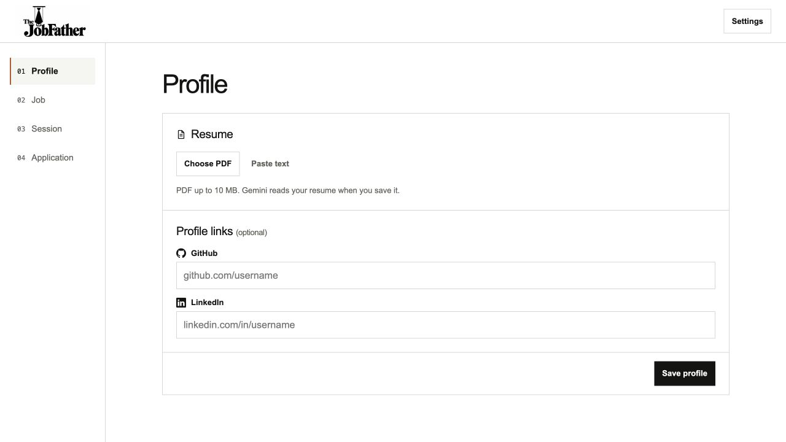

<p align="center">
  
</p>

<h1 align="center">Your experience. Better told.</h1>

<p align="center">
  Turn a conversation about your work into a tailored CV, cover letter, and job-fit analysis.<br>
  Built with Gemini and Gemini Live. Run it on your own computer with Docker.
</p>

<p align="center">
  <strong><a href="#quick-start">Quick start</a></strong> ·
  <strong><a href="#try-it-as-a-judge">Judge walkthrough</a></strong> ·
  <a href="#what-you-can-do">Features</a> ·
  <a href="docs/SETUP.md">Setup & troubleshooting</a>
</p>

---

## Meet TheJobFather

TheJobFather helps you prepare an application for a specific job using your resume
and the project details you add through conversation.

Bring your resume and a job posting. Talk through your work by chat or live voice,
review the facts the conversation uncovers, and turn the facts you approve into
an application you can edit and download.

**Profile → Job → Conversation → Approve facts → Application**



## What you can do

| Start with… | Walk away with… |
| --- | --- |
| Your resume PDF or pasted resume text | A saved profile grounded in your own experience. |
| A public job link or pasted posting | A role, company, and requirements you can review before starting. |
| A chat or interruptible live voice conversation | Relevant details that may be missing from your CV. Screen sharing is optional. |
| Facts you review, edit, and approve | Evidence the app can use in your drafts. Unapproved facts stay out. |
| Your saved profile and confirmed job | A tailored CV, cover letter, and job-fit analysis with supporting excerpts. |
| Feedback on the cover letter | Revised drafts, version history, and selectable-text CV / cover-letter PDFs. |

The app checks source references, numbers, and skills before saving drafts, and
asks Gemini to perform a consistency review. You still review the final result.

## Quick start

### 1. Have these ready

- **Docker Desktop**, installed **and running**. [Install Docker →](https://docs.docker.com/compose/install/)
  Linux users can also use Docker Engine with Compose v2.20+.
- **Git**, or an extracted copy of the source ZIP. [Install Git →](https://git-scm.com/downloads)
- **A Gemini API key** with access to the configured models and available quota.
  [Get a key in Google AI Studio →](https://aistudio.google.com/apikey)
- A browser and internet access. Provider usage limits and charges apply.

Docker includes the app’s Node.js and Python runtime dependencies. You do not need
to install either locally. On macOS with Homebrew, `brew bundle` installs the
Docker Desktop prerequisite declared in [Brewfile](Brewfile).

### 2. Start the app

Run in Terminal or PowerShell:

```sh
git clone https://github.com/attmous/thejobfather.git
cd thejobfather
docker compose up --build -d --wait
```

Already downloaded the source? Open a terminal in the extracted project folder
and run only the last command. The first build downloads dependencies. Wait for
both services to become healthy.

**Open [http://localhost:3000](http://localhost:3000/).**

The [interactive setup and judge guide](http://localhost:3000/landing) is also
available locally, with copyable commands and sample materials.

### 3. Add your key

In the app, open **Settings → API key**, paste your Gemini key, and choose
**Save key**. You’re ready to import a resume. No `.env` editing is needed for
the standard setup.

> **Need help starting?** See [troubleshooting](docs/SETUP.md#troubleshooting)
> for Docker startup, occupied ports, model access, and import problems.

## Try it as a judge

Use the fictional sample candidate to try the full workflow without supplying
your own CV. A working Gemini key is required; there is no shared demo key.

**Your test kit:** [Alex Morgan’s resume](docs/examples/resume.txt) ·
[Harbor Studio’s job posting](docs/examples/job.txt)

Open each sample on GitHub and copy its text using the file’s copy button or
the **Raw** view. All people, companies, and experience in these files are fictional.

- [ ] **Import a profile.** In **Profile → Paste text**, paste Alex’s resume and
  choose **Save profile**. Check that Alex’s name and experience appear.
- [ ] **Choose a job.** In **Job → Paste job description**, paste the sample job.
  Choose **Extract details**, review the role and company, then **Start session**.
- [ ] **Uncover a detail.** Choose **Start chat** and try this answer:
  “For the library app, I redesigned the checkout form after interviewing
  volunteers.” Review a captured fact, edit it if needed, and choose **Add to profile**.
- [ ] **Generate the application.** Choose **Create drafts**. Review **CV**,
  **Cover letter**, and **Job fit**. Kubernetes should remain a gap unless you
  provide evidence for it; the sample profile does not claim that experience.
- [ ] **Revise and export.** Ask for a shorter cover letter and choose
  **Revise letter**. Try an earlier version, then download both PDFs and check
  that you can select their text.

**Try voice, too:** In Session, choose **Call → Start call**, allow your
microphone, and speak naturally. Try interrupting or sharing a project screen.
Review and approve captured facts just as you would in chat. Voice requires
access to the configured Gemini Live model; the complete draft workflow also
works through text chat.

AI responses vary. The evaluation is about the full flow, evidence traceability,
your control over approved facts, and usable exported documents.

## Stop and come back later

```sh
docker compose down
# Start again when you’re ready:
docker compose up -d --wait
```

Your profile, imported resume, drafts, and saved key persist in a Docker volume.
**`docker compose down --volumes` deletes that workspace.**

## Your data and the current scope

- **Local workspace, cloud AI.** Saved work stays in a local Docker volume.
  Gemini receives the resume / job content and conversation context needed for
  AI features. Calls send microphone audio and any screen frames you choose to share.
- **Your key, your control.** The local backend saves the key with owner-only file
  permissions. The UI reports its status without returning the value.
- **Single-user hackathon build.** The app listens on your computer’s loopback
  address. It does not submit applications for you. Owner sign-in and spoken
  document revisions are not included yet.
- **Profile links are references.** GitHub and LinkedIn URLs can be saved, but
  their content is not automatically imported as career evidence.

## For builders

The frontend uses **Next.js / React**, the backend uses **Python / FastAPI**,
and the workspace is stored in **SQLite**. Docker Compose starts both services
with health checks; the frontend proxies API requests to the backend.

| Resource | What you’ll find |
| --- | --- |
| [Setup guide](docs/SETUP.md) | Configuration, troubleshooting, and running without Docker. |
| [Validation](docs/SETUP.md#validation) | Backend regression tests and an isolated Docker smoke check; no live AI calls required. |
| [Source ZIP](docs/SETUP.md#package-a-source-zip) | Package the current build for judges without secrets or private data. |
| [MVP specification](docs/MVP_SPEC.md) | Product scope and intended behavior. |
| [Roadmap](docs/INCREMENTAL_ROADMAP.md) · [Implementation plan](docs/IMPLEMENTATION_PLAN.md) | Delivery increments and technical planning. |
| [Open decisions](docs/OPEN_DECISIONS.md) | Product decisions still to confirm. |
